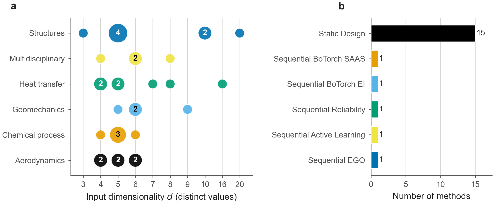

# DOE-Benchmark

**Physics-grounded engineering simulations for evaluating design-of-experiments
and surrogate-modelling guidance.**

DOE-Benchmark brings together an engineering case library, fixed
sampling–surrogate combinations and archived computational results. It supports
three questions: how method rankings transfer from analytical functions to
engineering cases, how sample budgets relate to prediction accuracy, and how
well surrogate-based failure probabilities match the simulated reference.

This repository accompanies the manuscript *Benchmarking design-of-experiments
guidance in physics-grounded engineering simulations*.

[Quick start](#quick-start) · [Data](#archived-data) ·
[Figures and tables](#figures-and-tables) · [Reproducibility](#reproducibility) ·
[中文速览](#中文速览)



## Benchmark at a glance

| Component | Coverage |
| --- | --- |
| Engineering cases | 34 deterministic, low-order simulators across six domains |
| Domains | Structures, heat transfer, aerodynamics, chemical processes, multidisciplinary design and geomechanics |
| Compared methods | 20 fixed sampling–surrogate combinations |
| Evaluation budgets | `5d`, `10d`, `20d` and `50d`, where `d` is the input dimension |
| Repeated runs | 30 per case–method–budget cell |
| Reference evaluation | A fixed 1,000-point Sobol' test set within each case |
| Main archive | 81,600 cells, including successful, failed and timed-out runs |
| Case grouping | Seven potentially overlapping response-feature labels |

The case library exposes a common interface: generate inputs in `[0, 1]^d`,
then call `case.evaluate(X)` to obtain physically dimensioned outputs.
Each case has an accompanying evidence note describing its equations,
implementation, source references and modelling limitations.

## Quick start

Use a Python environment with Python 3.11 and install the case library from the
repository root:

```sh
python -m pip install -e ./code
```

Evaluate a cantilever-beam case with a Latin-hypercube design:

```python
import doe_testbed as db
from scipy.stats.qmc import LatinHypercube

case = db.get_case("cantilever_beam_5d")
X = LatinHypercube(d=case.dim, seed=42).random(20)
Y = case.evaluate(X)

print(len(db.list_cases()))  # 34 registered cases
print(X.shape, Y.shape)      # (20, 5), (20, 3)
```

More examples are available in [`code/examples/`](code/examples/).

Optional dependencies are declared in
[`code/pyproject.toml`](code/pyproject.toml):

| Extra | Purpose |
| --- | --- |
| `aero` | NeuralFoil and AeroSandbox backends |
| `chem` | Cantera backend |
| `viz` | Visualisation |
| `benchmark` | Surrogates, Bayesian optimisation, statistical analysis and plotting |

For example, install the current benchmark dependencies with
`python -m pip install -e "./code[benchmark]"`.
For historical-sweep re-execution, use the archived startup record described
under [Reproducibility](#reproducibility).

## Archived data

The primary archive is
[`code/benchmark/results/full_benchmark/results.csv`](code/benchmark/results/full_benchmark/results.csv).

Its 81,600 rows cover the complete `34 × 20 × 4 × 30` grid:

| Run status | Rows |
| --- | ---: |
| Successful (`ok`) | 78,605 |
| Timed out (`timeout`) | 2,977 |
| Failed (`failed`) | 18 |

Each row identifies the case, method, budget and repeat, together with run
status, prediction-error metrics, timing and output-specific reliability
metrics. Retain the status column when analysing the archive: different
analyses apply the failure and denominator policies documented in the protocol.

| Analysis | Archived inputs and summaries |
| --- | --- |
| D1: ranking transfer | [`ranking_reversal/`](code/benchmark/results/ranking_reversal/) |
| D2: budget adequacy | [`sample_complexity_0.20/`](code/benchmark/results/sample_complexity_0.20/) |
| D3: failure-probability estimation | [`reliability_recovery/`](code/benchmark/results/reliability_recovery/) |
| Input-sensitivity recovery | [`sensitivity_recovery/`](code/benchmark/results/sensitivity_recovery/) |
| Exploratory design–model comparison | [`design_model_guidance/`](project_docs/manuscript_revision_20260926/design_model_guidance/) |

The D3 directory also includes
[`d3_output_aggregation_sensitivity.json`](code/benchmark/results/reliability_recovery/d3_output_aggregation_sensitivity.json):
the exploratory signed-mean output-aggregation summary uses the same 9,570
successful runs and 16 cases as the primary `10d` analysis.

## Figures and tables

[`manuscripts/figdata/`](manuscripts/figdata/) contains the numerical source
tables used to draw the figures. Corresponding reference exports are retained
in [`manuscripts/figures/`](manuscripts/figures/) as PDF, PNG and SVG files.

| Manuscript figure | Source CSV files |
| --- | --- |
| Fig. 1: case and method coverage | `fig1_case_catalog.csv`, `fig1_method_catalog.csv` |
| Fig. 2: ranking transfer | `fig2_d1_ranks.csv`, `fig2_d1_spearman.csv` |
| Fig. 3: budget adequacy | `fig3_d2_learning.csv`, `fig3_d2_rule.csv` |
| Fig. 4: failure-probability bias | `fig4_d3_bias.csv` |
| Supplementary Fig. S1: feature-group rankings | `fig5_mechanism.csv` |
| Supplementary Fig. S2: accuracy–runtime trade-offs | `fig6_pareto.csv` |

The `fig5` and `fig6` filenames correspond to Supplementary Figures S1 and S2.
[`manuscripts/tables/`](manuscripts/tables/) contains all 15 supplementary table
fragments and supporting tabulations. Numerical summaries are retained in
[`numbers.json`](manuscripts/numbers.json) and
[`numbers.tex`](manuscripts/numbers.tex).

To redraw figures from the retained figure-source tables, run from `code/`:

```sh
python scripts/plots_nature.py --figdata ../manuscripts/figdata --out-dir ../manuscripts/figures
```

## Reproducibility

The repository retains the analysis inputs, method configurations, case
implementations and computational records:

- [Protocol](manuscripts/protocol/preregistration.md),
  [amendment log](manuscripts/protocol/preregistration_amendments.md) and
  [decision record](manuscripts/protocol/preregistration_decisions.md).
- [Statistical analysis plan](code/docs/STATISTICAL_ANALYSIS_PLAN.md).
- [Method hyperparameters](code/benchmark/hyperparameters.py).
- [Formal startup configuration](code/benchmark/results/full_benchmark/run_config.json),
  including package versions, seeds and runtime settings.
- [Dependency listing](code/benchmark/results/full_benchmark/python_environment_pip_freeze.txt)
  retained with the archived results.
- Tests in [`code/tests/`](code/tests/) and
  [`code/benchmark/tests/`](code/benchmark/tests/).

Reading the archive and redrawing its figures use the retained results.
Repeating the full simulation sweep additionally requires reconstruction of the
original execution environment. The current benchmark-extra Torch constraint
is `>=2.2,<2.5`; the archived startup record lists `2.11.0+cpu`.

The [release check](project_docs/RELEASE_CHECK.md) records the verified file
coverage and outstanding environment and workflow-portability items.
Some older manuscript-generation scripts retain `code/paper/` defaults;
scripts with path options should be pointed to `manuscripts/`.

For a small sampling-API check, run from `code/` with pytest installed:

```sh
python -m pytest tests/test_utils.py::TestSampling -q
```

## Repository guide

```text
DOE-Benchmark/
├── code/
│   ├── doe_testbed/     Case library and evidence notes
│   ├── benchmark/       Methods, metrics, run scripts and archived results
│   ├── scripts/         Analysis and figure-generation utilities
│   ├── tests/           Case-library tests
│   ├── examples/        Usage examples
│   ├── docs/            Technical documentation and analysis plan
│   └── metadata/        Software and deposit metadata
├── manuscripts/
│   ├── figdata/         Figure-source CSVs
│   ├── figures/         Reference figure exports
│   ├── tables/          Supplementary table fragments
│   └── protocol/        Protocol and amendments
└── project_docs/        Retained exploratory summaries and release checks
```

Start with the [case overview](code/docs/CASE_OVERVIEW.md),
[case evidence index](code/docs/CASE_EVIDENCE_INDEX.md) and
[validation summary](code/docs/CASE_VALIDATION_SUMMARY.md) when selecting or
extending a case. Older technical guides retain their dated research context.

## Citation and license

Software and manuscript citation metadata are provided in
[`CITATION.cff`](CITATION.cff). The associated manuscript is prepared for
submission.

The software is distributed under the [MIT License](LICENSE). Case evidence
notes cite the underlying literature; the cited publications retain their
respective rights.

## 中文速览

DOE-Benchmark 围绕工程仿真中的试验设计、代理模型、样本预算和失效概率估计，
提供 34 个案例、20 个固定方法组合及完整的 81,600 单元运行记录。

- **使用案例库**：从仓库根目录执行 `python -m pip install -e ./code`，
  按上方示例生成归一化输入并调用 `case.evaluate(X)`。
- **读取数据**：主结果在 `code/benchmark/results/full_benchmark/results.csv`；
  D1、D2、D3 的派生分析分别存放在对应结果子目录。
- **对照图表**：`manuscripts/` 保存图表源数据、参考图件、S1–S15 表格片段、
  协议及数值汇总。
- **复现与扩展**：方法配置、随机种子和启动环境记录均已保留。
