# Benchmark Report: `full_benchmark`

Auto-generated by `benchmark.scripts.generate_report` on the
contents of `benchmark/results/full_benchmark/results.csv`.

**Coverage**

- cases   : 34
- methods : 20
- budgets : [5, 10, 20, 50] (multiples of d)
- repeats : 30
- rows    : 78605 successful out of 81600 (96.3%)

## Failure accounting

Downstream ranking sections use only `status == "ok"` rows for
complete-case accuracy comparisons. This section reports the unfiltered
row-status distribution so failed or timed-out cells remain visible in the
generated archive.

**Status counts:**

| status | n_rows | fraction |
|---|---|---|
| ok | 78605 | 0.963 |
| timeout | 2977 | 0.036 |
| failed | 18 | 0.000 |

**Failure-category counts:**

| failure_category | n_rows | fraction |
|---|---|---|
| ok | 78605 | 0.963 |
| timeout | 2977 | 0.036 |
| exception | 18 | 0.000 |

**Highest non-ok rates by method:**

| method | n_total | n_non_ok | non_ok_rate | failed | timeout |
|---|---|---|---|---|---|
| botorch_qei | 4080 | 664 | 0.163 | 0 | 664 |
| max_variance | 4080 | 654 | 0.160 | 0 | 654 |
| akmcs | 4080 | 594 | 0.146 | 0 | 594 |
| ego_ei | 4080 | 560 | 0.137 | 0 | 560 |
| lhs+gp | 4080 | 89 | 0.022 | 0 | 89 |
| sobol+gp | 4080 | 82 | 0.020 | 0 | 82 |
| random+gp | 4080 | 79 | 0.019 | 0 | 79 |
| halton+gp | 4080 | 78 | 0.019 | 0 | 78 |
| lhs_opt+gp | 4080 | 74 | 0.018 | 0 | 74 |
| lhs_opt+gp_rbf | 4080 | 61 | 0.015 | 0 | 61 |
| botorch_saasbo | 4080 | 60 | 0.015 | 18 | 42 |
| lhs_opt+gb | 4080 | 0 | 0.000 | 0 | 0 |
| lhs_opt+knn | 4080 | 0 | 0.000 | 0 | 0 |
| lhs_opt+mlp | 4080 | 0 | 0.000 | 0 | 0 |
| lhs_opt+poly3 | 4080 | 0 | 0.000 | 0 | 0 |
| lhs_opt+poly5 | 4080 | 0 | 0.000 | 0 | 0 |
| lhs_opt+rbf | 4080 | 0 | 0.000 | 0 | 0 |
| lhs_opt+rf | 4080 | 0 | 0.000 | 0 | 0 |
| lhs_opt+svr | 4080 | 0 | 0.000 | 0 | 0 |
| random+linear | 4080 | 0 | 0.000 | 0 | 0 |

**Highest non-ok rates by case:**

| case_id | n_total | n_non_ok | non_ok_rate | failed | timeout |
|---|---|---|---|---|---|
| variable_beam_20d | 2400 | 703 | 0.293 | 0 | 703 |
| multilayer_wall_16d | 2400 | 534 | 0.223 | 18 | 516 |
| ten_bar_truss_10d | 2400 | 242 | 0.101 | 0 | 242 |
| variable_beam_10d | 2400 | 240 | 0.100 | 0 | 240 |
| aircraft_conceptual_8d | 2400 | 210 | 0.087 | 0 | 210 |
| oil_reservoir_9d | 2400 | 163 | 0.068 | 0 | 163 |
| battery_thermal_7d | 2400 | 113 | 0.047 | 0 | 113 |
| multilayer_wall_8d | 2400 | 112 | 0.047 | 0 | 112 |
| dam_seepage_6d | 2400 | 90 | 0.037 | 0 | 90 |
| fixed_bed_reactor_6d | 2400 | 90 | 0.037 | 0 | 90 |
| groundwater_contamination_6d | 2400 | 90 | 0.037 | 0 | 90 |
| rotor_bemt_6d | 2400 | 90 | 0.037 | 0 | 90 |
| solar_pv_yield_6d | 2400 | 90 | 0.037 | 0 | 90 |
| wind_turbine_power_6d | 2400 | 90 | 0.037 | 0 | 90 |
| wing_vlm_6d | 2400 | 90 | 0.037 | 0 | 90 |
| laminar_flame_speed_5d | 2400 | 48 | 0.020 | 0 | 48 |
| airfoil_stall_2d | 2400 | 0 | 0.000 | 0 | 0 |
| airfoil_transonic_5d | 2400 | 0 | 0.000 | 0 | 0 |
| cantilever_beam_5d | 2400 | 0 | 0.000 | 0 | 0 |
| casting_solidification_5d | 2400 | 0 | 0.000 | 0 | 0 |

**First non-ok row examples:**

| case_id | method | budget_mult | repeat | status | failure_category | error |
|---|---|---|---|---|---|---|
| laminar_flame_speed_5d | ego_ei | 50 | 0 | timeout | timeout | timeout after 600s (ego_ei on laminar_flame_speed_5d, n_train=250) |
| laminar_flame_speed_5d | ego_ei | 50 | 4 | timeout | timeout | timeout after 600s (ego_ei on laminar_flame_speed_5d, n_train=250) |
| laminar_flame_speed_5d | ego_ei | 50 | 5 | timeout | timeout | timeout after 600s (ego_ei on laminar_flame_speed_5d, n_train=250) |
| laminar_flame_speed_5d | ego_ei | 50 | 7 | timeout | timeout | timeout after 600s (ego_ei on laminar_flame_speed_5d, n_train=250) |
| laminar_flame_speed_5d | ego_ei | 50 | 9 | timeout | timeout | timeout after 600s (ego_ei on laminar_flame_speed_5d, n_train=250) |
| laminar_flame_speed_5d | ego_ei | 50 | 10 | timeout | timeout | timeout after 600s (ego_ei on laminar_flame_speed_5d, n_train=250) |
| laminar_flame_speed_5d | ego_ei | 50 | 11 | timeout | timeout | timeout after 600s (ego_ei on laminar_flame_speed_5d, n_train=250) |
| laminar_flame_speed_5d | ego_ei | 50 | 12 | timeout | timeout | timeout after 600s (ego_ei on laminar_flame_speed_5d, n_train=250) |
| laminar_flame_speed_5d | ego_ei | 50 | 13 | timeout | timeout | timeout after 600s (ego_ei on laminar_flame_speed_5d, n_train=250) |
| laminar_flame_speed_5d | ego_ei | 50 | 14 | timeout | timeout | timeout after 600s (ego_ei on laminar_flame_speed_5d, n_train=250) |

## Executive Summary

**Headline finding** (NRMSE @ 50·d on 19 cases, 20 methods):

- Friedman χ² = 309.6, p = 2.1e-54; Nemenyi CD (α=0.05) = 6.80.

- Best mean rank: **`max_variance`** (rank 3.11), followed by `halton+gp`.

- Worst mean rank: `random+linear` (rank 19.63).

- Pareto-optimal compute-vs-accuracy: `max_variance`, `lhs_opt+gp`, `sobol+gp`, `halton+gp`, `lhs_opt+gp_rbf`, `lhs_opt+rbf`, `lhs_opt+poly3`, `lhs_opt+knn`, `random+linear`.

- Largest per-output imbalance: `lhs_opt+mlp` with spread = 0.498 (out0/out1/out2 NRMSE differ wildly — see §7).

**Robustness checks**:

- Cross-metric ranking consistency: min Spearman ρ = **1.000** (headline holds under all of nrmse, rmse, mae, maxae, q95ae, r2).

- Sample size: 19 cases × 30 repeats; bootstrap CI in §2.

- Holm-Bonferroni post-hoc (Wilcoxon, α=0.05): **131 / 190 pairs** (69 %) significantly different; details in §3b.

- **Dimensional scaling**: `lhs_opt+svr` rank shifts by 14.6 positions across dim bands — see §7c.

- **Curse-of-dim severity**: `botorch_saasbo` has log-NRMSE-vs-dim slope = 0.144 (R² = 0.03) — degrades fastest with dimension.

## 1. Headline ranking

Headline metric: NRMSE on the largest budget (50·d) over the 19 cases
where every method completed.

- Friedman χ² = **309.65**, p = **2.10e-54**
- Critical difference (Nemenyi α = 0.05) = **6.802**
- Methods within 6.80 mean-rank units are not statistically separable.

| method | mean_rank |
|---|---|
| max_variance | 3.105 |
| halton+gp | 3.421 |
| sobol+gp | 3.579 |
| lhs_opt+gp | 3.737 |
| lhs_opt+gp_rbf | 4.842 |
| lhs+gp | 6.421 |
| random+gp | 6.737 |
| botorch_saasbo | 7.842 |
| ego_ei | 8.684 |
| akmcs | 8.842 |
| botorch_qei | 10.895 |
| lhs_opt+rbf | 12.632 |
| lhs_opt+poly5 | 13.105 |
| lhs_opt+poly3 | 13.526 |
| lhs_opt+rf | 15.316 |
| lhs_opt+gb | 15.684 |
| lhs_opt+svr | 16.579 |
| lhs_opt+mlp | 17.000 |
| lhs_opt+knn | 18.421 |
| random+linear | 19.632 |

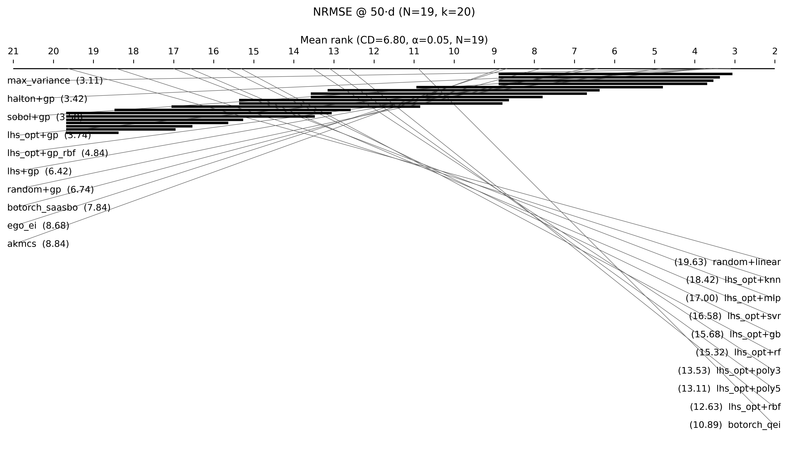

## 1b. Budget-induced rank shifts (5·d → 50·d)

How does each method's rank change as the training budget grows
from `5·d` to `50·d`?  We resample cases with
replacement (n_boot = 1000) to obtain a 95 % bootstrap CI on
the rank shift.  A method whose CI excludes zero has a
statistically robust rank change between the two budgets.

- **Negative shift** = method *improves* (climbs the ranking)
  when the budget grows.
- **Positive shift** = method *degrades* relative to peers as
  the budget grows.
- `shift_significant = True` ⇒ rank change is robust to case
  resampling at α = 0.05 (one-sided).

**12 / 20 methods have a statistically robust rank shift between the two budgets at α = 0.05.**

| method | rank_a | rank_b | shift | shift_ci_low | shift_ci_high | shift_significant |
|---|---|---|---|---|---|---|
| lhs_opt+gb | 19.379 | 15.684 | -3.695 | -4.952 | -2.413 | True |
| lhs_opt+gp_rbf | 7.517 | 4.842 | -2.675 | -5.207 | -0.259 | True |
| random+gp | 9.345 | 6.737 | -2.608 | -3.971 | -1.342 | True |
| akmcs | 10.966 | 8.842 | -2.123 | -4.143 | 0.105 | False |
| halton+gp | 5.483 | 3.421 | -2.062 | -3.376 | -0.538 | True |
| max_variance | 5.034 | 3.105 | -1.929 | -4.288 | 0.311 | False |
| sobol+gp | 5.138 | 3.579 | -1.559 | -3.031 | -0.278 | True |
| ego_ei | 10.138 | 8.684 | -1.454 | -3.324 | 0.163 | False |
| lhs+gp | 7.517 | 6.421 | -1.096 | -2.830 | 0.556 | False |
| lhs_opt+poly5 | 13.483 | 13.105 | -0.377 | -1.689 | 1.206 | False |
| lhs_opt+rf | 15.103 | 15.316 | 0.212 | -1.841 | 2.076 | False |
| botorch_qei | 10.448 | 10.895 | 0.446 | -0.707 | 1.546 | False |
| lhs_opt+gp | 3.241 | 3.737 | 0.495 | -0.934 | 1.674 | False |
| lhs_opt+svr | 14.724 | 16.579 | 1.855 | 0.471 | 3.529 | True |
| botorch_saasbo | 5.862 | 7.842 | 1.980 | 0.648 | 3.217 | True |
| lhs_opt+knn | 16.379 | 18.421 | 2.042 | 0.846 | 3.478 | True |
| lhs_opt+poly3 | 11.448 | 13.526 | 2.078 | 0.716 | 3.622 | True |
| lhs_opt+mlp | 14.310 | 17.000 | 2.690 | 0.107 | 5.478 | True |
| lhs_opt+rbf | 8.759 | 12.632 | 3.873 | 2.122 | 5.813 | True |
| random+linear | 15.724 | 19.632 | 3.907 | 3.083 | 4.848 | True |

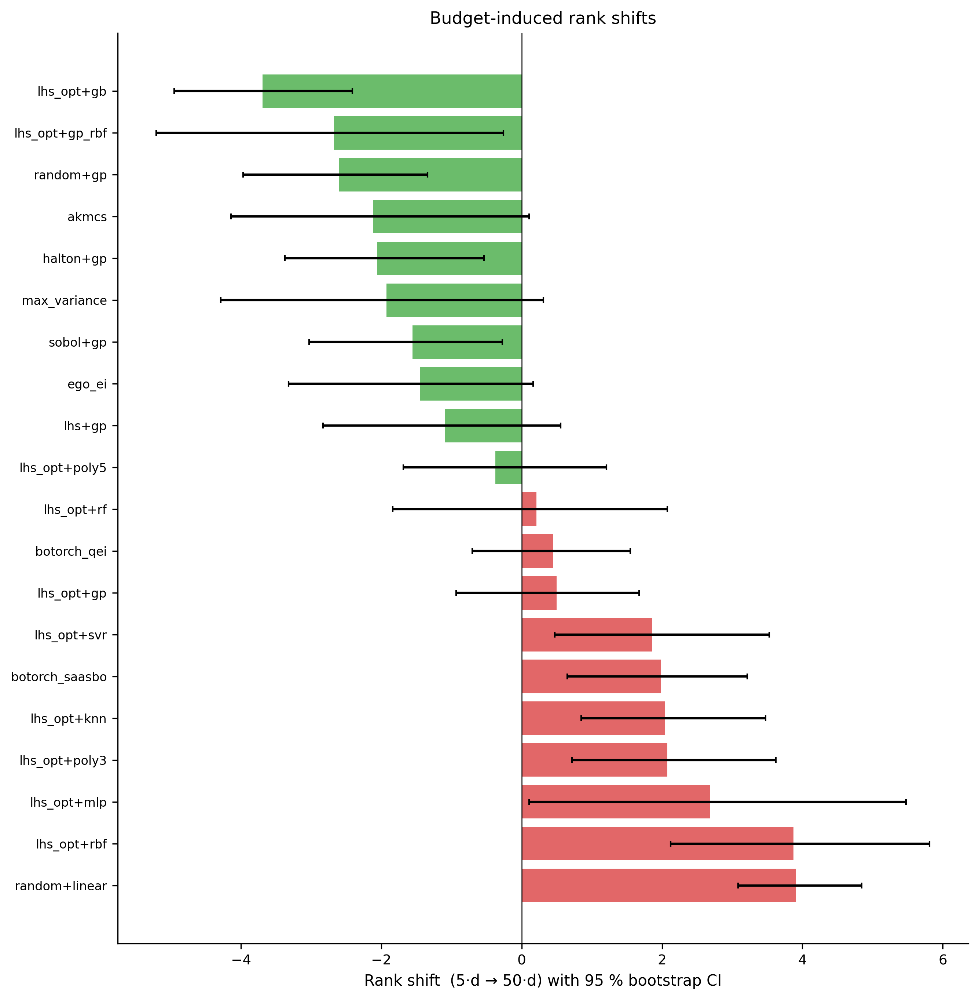

## 2. Bootstrap rank CI

Each method's mean rank with a 95 % bootstrap CI obtained by
resampling cases with replacement (n_boot=1000).  Methods with
overlapping CIs are not statistically distinguishable on this
sample of cases.

| method | mean_rank | ci_low | ci_high | ci_width |
|---|---|---|---|---|
| max_variance | 3.105 | 2.000 | 4.369 | 2.369 |
| halton+gp | 3.421 | 2.588 | 4.422 | 1.834 |
| sobol+gp | 3.579 | 2.636 | 4.500 | 1.864 |
| lhs_opt+gp | 3.737 | 3.143 | 4.357 | 1.214 |
| lhs_opt+gp_rbf | 4.842 | 3.444 | 6.300 | 2.856 |
| lhs+gp | 6.421 | 5.399 | 7.429 | 2.030 |
| random+gp | 6.737 | 6.090 | 7.400 | 1.310 |
| botorch_saasbo | 7.842 | 6.785 | 8.846 | 2.061 |
| ego_ei | 8.684 | 7.363 | 10.000 | 2.637 |
| akmcs | 8.842 | 7.266 | 10.611 | 3.345 |
| botorch_qei | 10.895 | 10.385 | 11.438 | 1.053 |
| lhs_opt+rbf | 12.632 | 11.833 | 13.526 | 1.693 |
| lhs_opt+poly5 | 13.105 | 12.526 | 13.750 | 1.224 |
| lhs_opt+poly3 | 13.526 | 12.692 | 14.412 | 1.720 |
| lhs_opt+rf | 15.316 | 13.646 | 16.550 | 2.904 |
| lhs_opt+gb | 15.684 | 14.600 | 16.556 | 1.956 |
| lhs_opt+svr | 16.579 | 15.933 | 17.308 | 1.374 |
| lhs_opt+mlp | 17.000 | 15.733 | 18.125 | 2.392 |
| lhs_opt+knn | 18.421 | 17.938 | 18.889 | 0.951 |
| random+linear | 19.632 | 19.400 | 19.842 | 0.442 |

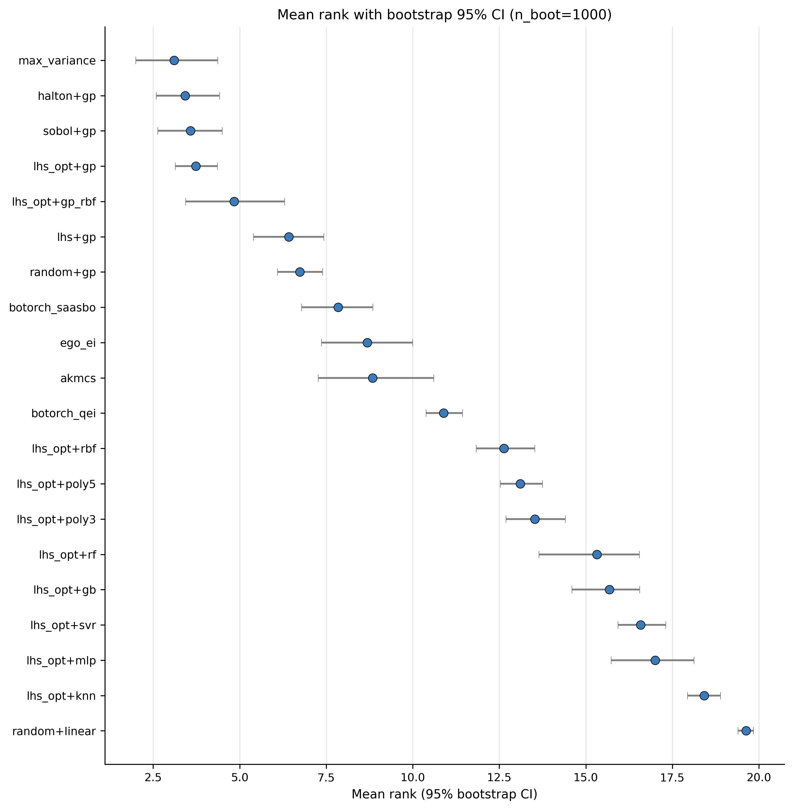

## 3. Pairwise win-rate matrix

Each cell `(i, j)` = fraction of (case, repeat) pairs in which method
`i` has lower NRMSE than method `j` (paired comparison on the same
test set).  Diagonal omitted.  Rows are sorted by *dominance score*
= mean win rate against all other methods.

**Dominance score (mean win rate against all opponents):**

| method | dominance |
|---|---|
| max_variance | 0.889 |
| sobol+gp | 0.884 |
| halton+gp | 0.874 |
| lhs_opt+gp | 0.860 |
| lhs_opt+gp_rbf | 0.770 |
| lhs+gp | 0.721 |
| random+gp | 0.703 |
| botorch_saasbo | 0.620 |
| ego_ei | 0.596 |
| akmcs | 0.587 |
| botorch_qei | 0.480 |
| lhs_opt+rbf | 0.395 |
| lhs_opt+poly5 | 0.355 |
| lhs_opt+poly3 | 0.334 |
| lhs_opt+gb | 0.246 |
| lhs_opt+rf | 0.222 |
| lhs_opt+svr | 0.192 |
| lhs_opt+mlp | 0.167 |
| lhs_opt+knn | 0.065 |
| random+linear | 0.040 |

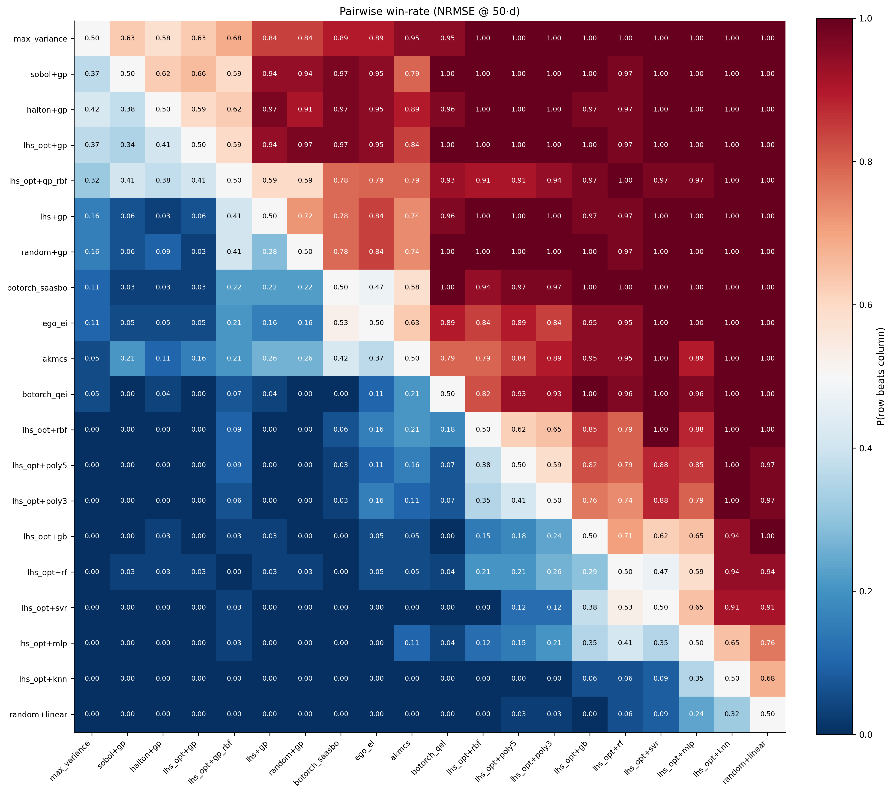

## 3b. Pairwise Holm-Bonferroni significance test

For every method pair we run a paired Wilcoxon signed-rank test on
per-case mean NRMSE and apply the Holm-Bonferroni procedure to
control family-wise error rate at α=0.05.  Compared to the Nemenyi
CD test (§1), this is a *more powerful* post-hoc — it uses
paired-difference information instead of average ranks.

**131 / 190 method pairs (69 %) are significantly different at family-wise α=0.05.**

**Top-10 most significant pairs:**

| method_A | method_B | n_cases | mean_diff | p_raw | p_holm |
|---|---|---|---|---|---|
| akmcs | lhs_opt+svr | 19 | -0.155 | 0.000 | 0.001 |
| akmcs | lhs_opt+knn | 19 | -0.240 | 0.000 | 0.001 |
| botorch_qei | botorch_saasbo | 19 | 0.023 | 0.000 | 0.001 |
| botorch_qei | lhs_opt+knn | 19 | -0.236 | 0.000 | 0.001 |
| botorch_qei | lhs_opt+gp | 19 | 0.035 | 0.000 | 0.001 |
| botorch_qei | lhs+gp | 19 | 0.029 | 0.000 | 0.001 |
| akmcs | random+linear | 19 | -0.360 | 0.000 | 0.001 |
| ego_ei | lhs_opt+knn | 19 | -0.251 | 0.000 | 0.001 |
| botorch_saasbo | lhs_opt+gb | 19 | -0.143 | 0.000 | 0.001 |
| botorch_saasbo | lhs_opt+knn | 19 | -0.259 | 0.000 | 0.001 |

**Equivalent (non-significant) pairs — method swaps with no measurable effect:**

| method_A | method_B | n_cases | mean_diff | p_holm |
|---|---|---|---|---|
| lhs_opt+gp_rbf | sobol+gp | 19 | 0.013 | 1.000 |
| lhs_opt+mlp | lhs_opt+rf | 19 | 0.121 | 1.000 |
| lhs_opt+mlp | random+linear | 19 | -0.108 | 1.000 |
| lhs_opt+poly3 | lhs_opt+rbf | 19 | 0.023 | 1.000 |
| lhs_opt+mlp | lhs_opt+svr | 19 | 0.098 | 1.000 |
| lhs_opt+poly5 | lhs_opt+rbf | 19 | 0.010 | 1.000 |
| lhs_opt+rf | lhs_opt+svr | 19 | -0.023 | 1.000 |
| max_variance | sobol+gp | 19 | 0.001 | 1.000 |

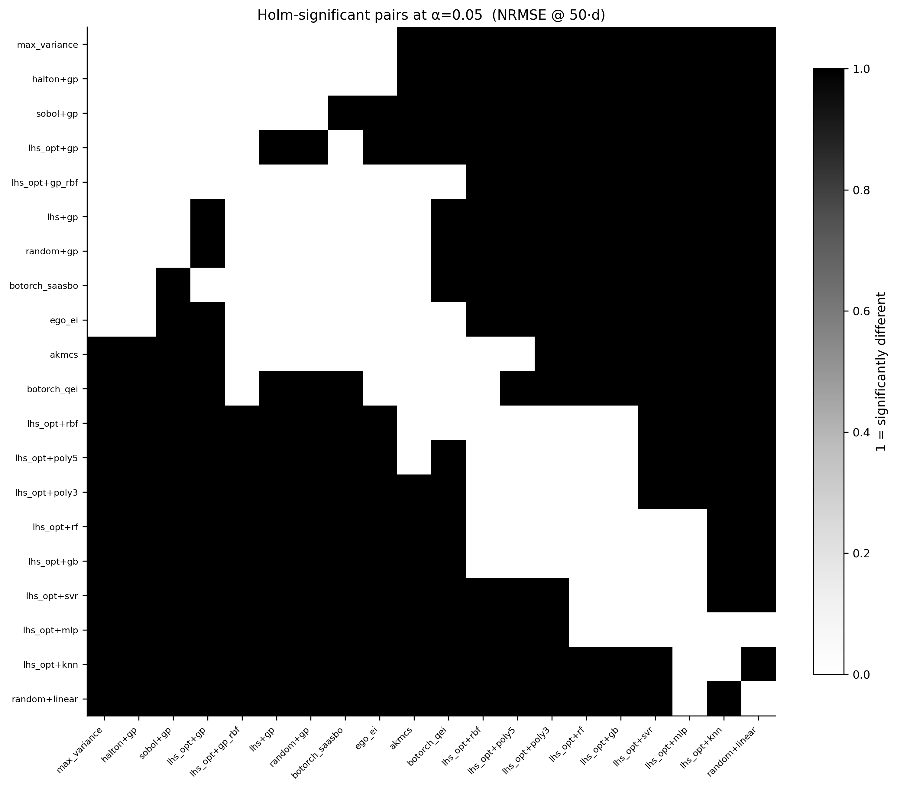

## 4. Cliff's delta effect-size matrix (with 95 % CI)

Cliff's δ is a non-parametric effect-size measure.

- |δ| < 0.147 : negligible
- 0.147–0.33  : small
- 0.33–0.474  : medium
- ≥ 0.474     : large

A method `i` "soundly beats" `j` only when δ(i, j) is medium or large
**and** the 95 % bootstrap CI on δ excludes 0.  We hatch cells whose
CI overlaps zero so they are visually distinguishable from cells
that are simultaneously large *and* statistically robust.

**137 ordered pairs of methods are non-negligible (|δ| ≥ 0.147 with CI excluding 0) at the 50·d budget.**

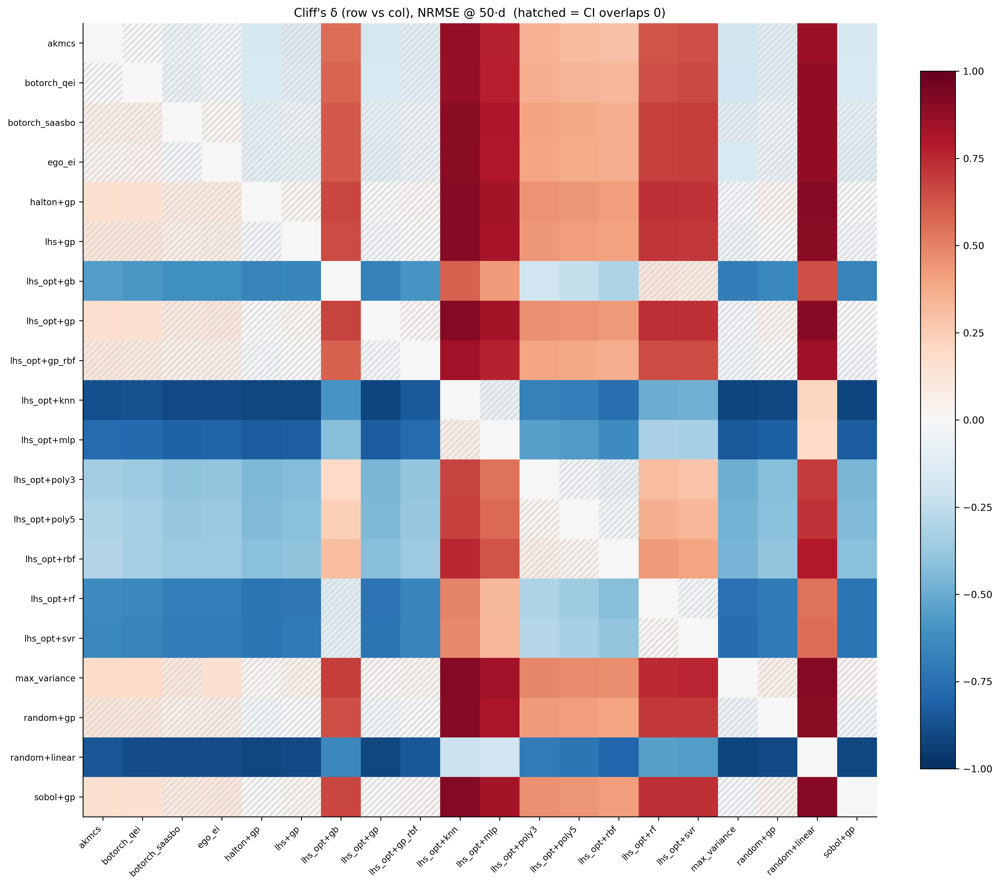

## 5. Compute-vs-accuracy Pareto front

The Pareto-optimal frontier identifies methods that are not
strictly dominated on both axes (cost and accuracy).  Methods on
the front are the only sensible compute-budget choices; methods
below it are dominated and should not be recommended for that
budget.

| method | mean_metric | median_metric | mean_cost | median_cost | n | on_pareto |
|---|---|---|---|---|---|---|
| max_variance | 0.102 | 0.076 | 298.060 | 276.522 | 570 | True |
| lhs_opt+gp | 0.107 | 0.073 | 27.978 | 12.771 | 960 | True |
| sobol+gp | 0.108 | 0.073 | 27.895 | 12.435 | 960 | True |
| halton+gp | 0.109 | 0.072 | 27.078 | 12.221 | 960 | True |
| lhs+gp | 0.113 | 0.077 | 28.383 | 12.329 | 960 | False |
| random+gp | 0.114 | 0.080 | 28.738 | 12.552 | 960 | False |
| botorch_saasbo | 0.122 | 0.084 | 35.334 | 14.283 | 960 | False |
| ego_ei | 0.124 | 0.101 | 320.967 | 314.088 | 550 | False |
| botorch_qei | 0.130 | 0.099 | 507.800 | 409.890 | 806 | False |
| lhs_opt+gp_rbf | 0.130 | 0.077 | 20.709 | 8.381 | 960 | True |
| akmcs | 0.138 | 0.106 | 353.444 | 336.150 | 542 | False |
| lhs_opt+rbf | 0.193 | 0.179 | 3.206 | 1.152 | 1020 | True |
| lhs_opt+poly5 | 0.211 | 0.180 | 3.468 | 1.137 | 1020 | False |
| lhs_opt+poly3 | 0.222 | 0.207 | 3.150 | 1.133 | 1020 | True |
| lhs_opt+gb | 0.265 | 0.242 | 3.388 | 1.417 | 1020 | False |
| lhs_opt+svr | 0.296 | 0.275 | 3.160 | 1.158 | 1020 | False |
| lhs_opt+rf | 0.301 | 0.273 | 4.354 | 1.959 | 1020 | False |
| lhs_opt+knn | 0.424 | 0.363 | 3.096 | 1.150 | 1020 | True |
| random+linear | 0.476 | 0.464 | 1.941 | 0.030 | 1020 | True |
| lhs_opt+mlp | 0.627 | 0.364 | 5.733 | 3.584 | 1020 | False |

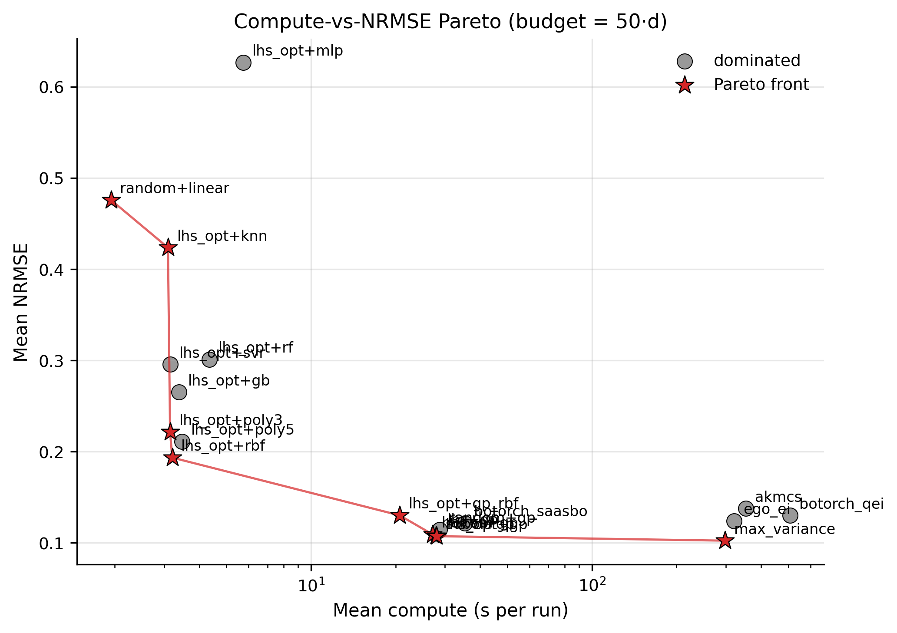

## 6. Stratified ranks

Mean rank per method, stratified by case attribute.  This reveals
whether a single overall winner is genuinely best across all
physics regimes, or only on a subset.

**VS scenario** — top-3 methods per stratum:

| stratum | N | friedman_p | CD | best | 2nd | 3rd |
|---|---|---|---|---|---|---|
| VS-A | 8 | 0.000 | 11.207 | halton+gp | sobol+gp | lhs_opt+gp |
| VS-B | 10 | 0.000 | 14.826 | max_variance | lhs_opt+gp_rbf | lhs_opt+gp |
| VS-C | 23 | 0.000 | 7.656 | max_variance | halton+gp | sobol+gp |
| VS-D | 9 | 0.000 | 12.105 | max_variance | sobol+gp | lhs_opt+gp |
| VS-E | 9 | 0.014 | 20.967 | max_variance | halton+gp | lhs_opt+gp |
| VS-F | 18 | 0.000 | 9.377 | max_variance | halton+gp | lhs_opt+gp |
| VS-G | 11 | 0.000 | 10.483 | sobol+gp | lhs_opt+gp | max_variance |
| VS-H | 6 | 0.000 | 14.826 | lhs_opt+gp | max_variance | sobol+gp |

**Topology** — top-3 methods per stratum:

| stratum | N | friedman_p | CD | best | 2nd | 3rd |
|---|---|---|---|---|---|---|
| discontinuous | 5 | 0.041 | 20.967 | lhs_opt+gp_rbf | max_variance | lhs_opt+gp |
| heterogeneous | 8 | 0.000 | 12.105 | sobol+gp | halton+gp | lhs_opt+gp |
| smooth_monotone | 19 | 0.000 | 9.884 | max_variance | halton+gp | lhs_opt+gp |
| smooth_unimodal | 14 | 0.000 | 9.884 | halton+gp | max_variance | sobol+gp |
| sparse_effects | 5 | — | 29.651 | max_variance | halton+gp | lhs_opt+gp |
| strong_interaction | 21 | 0.000 | 8.940 | sobol+gp | halton+gp | lhs_opt+gp |
| threshold_jump | 8 | 0.000 | 12.105 | max_variance | halton+gp | lhs_opt+gp |

**Domain** — top-3 methods per stratum:

| stratum | N | friedman_p | CD | best | 2nd | 3rd |
|---|---|---|---|---|---|---|
| aerodynamics | 6 | 0.000 | 14.826 | max_variance | halton+gp | lhs_opt+gp |
| chemical_process | 5 | 0.000 | 14.826 | max_variance | lhs_opt+gp_rbf | sobol+gp |
| geomechanics | 4 | — | 29.651 | sobol+gp | halton+gp | lhs_opt+gp |
| heat_transfer | 7 | 0.000 | 14.826 | max_variance | halton+gp | sobol+gp |
| multidisciplinary | 4 | — | 29.651 | max_variance | lhs_opt+gp_rbf | sobol+gp |
| structures | 8 | 0.000 | 13.260 | halton+gp | lhs_opt+gp | sobol+gp |

**Dimension bucket** — top-3 methods per stratum:

| stratum | N | friedman_p | CD | best | 2nd | 3rd |
|---|---|---|---|---|---|---|
| high | 5 | 0.001 | 13.318 | sobol+gp | halton+gp | lhs_opt+gp |
| low | 7 | 0.000 | 11.207 | max_variance | sobol+gp | halton+gp |
| mid | 22 | 0.000 | 8.560 | halton+gp | lhs_opt+gp | max_variance |

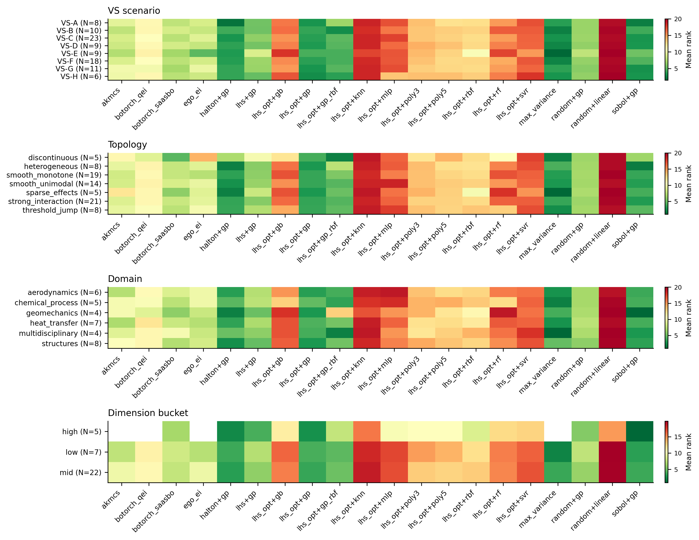

## 7. Per-output disaggregation

Each case has 3 outputs.  The headline NRMSE averages over them,
which can hide methods that are great on one output and terrible
on another.  Here we report:

- *mean_worst*: mean of the worst per-case NRMSE across outputs
- *mean_spread*: mean of the (max - min) NRMSE across outputs
- *rank_shift*: how much rank degrades on the worst output

**Per-output mean NRMSE (sorted by worst-output performance):**

| method | nrmse_out0_mean | nrmse_out1_mean | nrmse_out2_mean | mean_avg | mean_worst | mean_best | mean_spread |
|---|---|---|---|---|---|---|---|
| lhs_opt+gp | 0.096 | 0.149 | 0.076 | 0.107 | 0.149 | 0.076 | 0.073 |
| sobol+gp | 0.095 | 0.153 | 0.075 | 0.108 | 0.153 | 0.075 | 0.079 |
| max_variance | 0.084 | 0.155 | 0.068 | 0.102 | 0.155 | 0.068 | 0.086 |
| halton+gp | 0.096 | 0.155 | 0.077 | 0.109 | 0.155 | 0.077 | 0.078 |
| lhs+gp | 0.101 | 0.157 | 0.081 | 0.113 | 0.157 | 0.081 | 0.076 |
| random+gp | 0.104 | 0.158 | 0.082 | 0.114 | 0.158 | 0.082 | 0.077 |
| botorch_saasbo | 0.118 | 0.164 | 0.084 | 0.122 | 0.164 | 0.084 | 0.080 |
| ego_ei | 0.122 | 0.164 | 0.085 | 0.124 | 0.164 | 0.085 | 0.079 |
| botorch_qei | 0.122 | 0.174 | 0.095 | 0.130 | 0.174 | 0.095 | 0.079 |
| akmcs | 0.137 | 0.186 | 0.089 | 0.138 | 0.186 | 0.089 | 0.098 |
| lhs_opt+gp_rbf | 0.110 | 0.190 | 0.090 | 0.130 | 0.190 | 0.090 | 0.100 |
| lhs_opt+rbf | 0.196 | 0.228 | 0.156 | 0.193 | 0.228 | 0.156 | 0.071 |
| lhs_opt+poly5 | 0.210 | 0.254 | 0.169 | 0.211 | 0.254 | 0.169 | 0.084 |
| lhs_opt+poly3 | 0.211 | 0.279 | 0.174 | 0.222 | 0.279 | 0.174 | 0.105 |
| lhs_opt+gb | 0.258 | 0.297 | 0.241 | 0.265 | 0.297 | 0.241 | 0.056 |
| lhs_opt+svr | 0.302 | 0.317 | 0.268 | 0.296 | 0.317 | 0.268 | 0.049 |
| lhs_opt+rf | 0.288 | 0.341 | 0.274 | 0.301 | 0.341 | 0.274 | 0.067 |
| lhs_opt+knn | 0.432 | 0.436 | 0.402 | 0.424 | 0.436 | 0.402 | 0.034 |
| random+linear | 0.493 | 0.523 | 0.411 | 0.476 | 0.523 | 0.411 | 0.112 |
| lhs_opt+mlp | 0.548 | 0.915 | 0.416 | 0.627 | 0.915 | 0.416 | 0.498 |

**Mean rank on each output and rank shift (max-min):**

| method | rank_avg | rank_out0 | rank_out1 | rank_out2 | rank_max | rank_min | rank_shift |
|---|---|---|---|---|---|---|---|
| max_variance | 2.842 | 1.947 | 4.316 | 3.000 | 4.316 | 1.947 | 1.474 |
| lhs_opt+gp | 2.938 | 3.344 | 3.562 | 4.156 | 4.156 | 3.344 | 1.219 |
| halton+gp | 3.250 | 3.562 | 3.688 | 4.281 | 4.281 | 3.562 | 1.031 |
| lhs+gp | 5.406 | 5.750 | 6.000 | 6.438 | 6.438 | 5.750 | 1.031 |
| random+gp | 6.125 | 6.500 | 6.469 | 7.000 | 7.000 | 6.469 | 0.875 |
| sobol+gp | 2.969 | 3.031 | 3.812 | 3.344 | 3.812 | 3.031 | 0.844 |
| botorch_qei | 10.000 | 10.286 | 10.750 | 9.929 | 10.750 | 9.929 | 0.750 |
| botorch_saasbo | 7.531 | 7.625 | 7.688 | 8.219 | 8.219 | 7.625 | 0.688 |
| akmcs | 9.105 | 9.789 | 8.947 | 7.421 | 9.789 | 7.421 | 0.684 |
| lhs_opt+gp_rbf | 5.625 | 5.438 | 6.125 | 6.188 | 6.188 | 5.438 | 0.562 |
| lhs_opt+poly5 | 11.382 | 11.500 | 11.000 | 11.794 | 11.794 | 11.000 | 0.412 |
| lhs_opt+svr | 14.412 | 14.353 | 13.559 | 14.794 | 14.794 | 13.559 | 0.382 |
| lhs_opt+rf | 14.059 | 14.029 | 14.235 | 14.265 | 14.265 | 14.029 | 0.206 |
| ego_ei | 8.526 | 8.684 | 8.158 | 7.737 | 8.684 | 7.737 | 0.158 |
| lhs_opt+knn | 16.853 | 16.941 | 16.088 | 16.971 | 16.971 | 16.088 | 0.118 |
| lhs_opt+gb | 13.441 | 13.324 | 12.618 | 13.500 | 13.500 | 12.618 | 0.059 |
| lhs_opt+rbf | 10.676 | 10.559 | 9.765 | 9.441 | 10.559 | 9.441 | -0.118 |
| random+linear | 17.324 | 16.882 | 17.118 | 14.676 | 17.118 | 14.676 | -0.206 |
| lhs_opt+poly3 | 11.882 | 11.618 | 11.471 | 11.618 | 11.618 | 11.471 | -0.265 |
| lhs_opt+mlp | 14.941 | 14.235 | 14.676 | 13.824 | 14.676 | 13.824 | -0.265 |

## 7b. Learning curves & convergence rates

Power-law convergence: NRMSE ≈ A · n^{-α}.  A method with
higher α improves faster as the training budget grows.
Methods whose ranking changes between budgets are
budget-dependent (no free lunch).

**Mean rank at each budget:**

| method | 5 | 10 | 20 | 50 |
|---|---|---|---|---|
| akmcs | 10.966 | 9.448 | 9.143 | 8.842 |
| botorch_qei | 10.448 | 10.586 | 10.571 | 10.895 |
| botorch_saasbo | 5.862 | 6.586 | 7.464 | 7.842 |
| ego_ei | 10.138 | 8.414 | 8.750 | 8.684 |
| halton+gp | 5.483 | 4.759 | 4.179 | 3.421 |
| lhs+gp | 7.517 | 7.069 | 6.250 | 6.421 |
| lhs_opt+gb | 19.379 | 18.966 | 16.214 | 15.684 |
| lhs_opt+gp | 3.241 | 3.103 | 2.893 | 3.737 |
| lhs_opt+gp_rbf | 7.517 | 8.276 | 7.036 | 4.842 |
| lhs_opt+knn | 16.379 | 17.759 | 18.393 | 18.421 |
| lhs_opt+mlp | 14.310 | 16.724 | 17.429 | 17.000 |
| lhs_opt+poly3 | 11.448 | 11.586 | 12.571 | 13.526 |
| lhs_opt+poly5 | 13.483 | 12.828 | 13.286 | 13.105 |
| lhs_opt+rbf | 8.759 | 9.828 | 11.714 | 12.632 |
| lhs_opt+rf | 15.103 | 15.310 | 15.536 | 15.316 |
| lhs_opt+svr | 14.724 | 15.586 | 16.357 | 16.579 |
| max_variance | 5.034 | 3.655 | 2.536 | 3.105 |
| random+gp | 9.345 | 8.000 | 7.607 | 6.737 |
| random+linear | 15.724 | 17.138 | 18.679 | 19.632 |
| sobol+gp | 5.138 | 4.379 | 3.393 | 3.579 |

**Rank stability (range across budgets):**

| method | rank_min | rank_max | rank_range | rank_first | rank_last | rank_trend |
|---|---|---|---|---|---|---|
| random+linear | 15.724 | 19.632 | 3.907 | 15.724 | 19.632 | 3.907 |
| lhs_opt+rbf | 8.759 | 12.632 | 3.873 | 8.759 | 12.632 | 3.873 |
| lhs_opt+gb | 15.684 | 19.379 | 3.695 | 19.379 | 15.684 | -3.695 |
| lhs_opt+gp_rbf | 4.842 | 8.276 | 3.434 | 7.517 | 4.842 | -2.675 |
| lhs_opt+mlp | 14.310 | 17.429 | 3.118 | 14.310 | 17.000 | 2.690 |
| random+gp | 6.737 | 9.345 | 2.608 | 9.345 | 6.737 | -2.608 |
| max_variance | 2.536 | 5.034 | 2.499 | 5.034 | 3.105 | -1.929 |
| akmcs | 8.842 | 10.966 | 2.123 | 10.966 | 8.842 | -2.123 |
| lhs_opt+poly3 | 11.448 | 13.526 | 2.078 | 11.448 | 13.526 | 2.078 |
| halton+gp | 3.421 | 5.483 | 2.062 | 5.483 | 3.421 | -2.062 |
| lhs_opt+knn | 16.379 | 18.421 | 2.042 | 16.379 | 18.421 | 2.042 |
| botorch_saasbo | 5.862 | 7.842 | 1.980 | 5.862 | 7.842 | 1.980 |
| lhs_opt+svr | 14.724 | 16.579 | 1.855 | 14.724 | 16.579 | 1.855 |
| sobol+gp | 3.393 | 5.138 | 1.745 | 5.138 | 3.579 | -1.559 |
| ego_ei | 8.414 | 10.138 | 1.724 | 10.138 | 8.684 | -1.454 |
| lhs+gp | 6.250 | 7.517 | 1.267 | 7.517 | 6.421 | -1.096 |
| lhs_opt+gp | 2.893 | 3.737 | 0.844 | 3.241 | 3.737 | 0.495 |
| lhs_opt+poly5 | 12.828 | 13.483 | 0.655 | 13.483 | 13.105 | -0.377 |
| botorch_qei | 10.448 | 10.895 | 0.446 | 10.448 | 10.895 | 0.446 |
| lhs_opt+rf | 15.103 | 15.536 | 0.432 | 15.103 | 15.316 | 0.212 |

**Power-law convergence rates (NRMSE ∝ n^{-α})****:**

| method | alpha_mean | alpha_median | alpha_min | alpha_max | R2_median | n_cases |
|---|---|---|---|---|---|---|
| max_variance | 0.756 | 0.567 | 0.180 | 1.645 | 0.991 | 33 |
| lhs_opt+gp_rbf | 0.747 | 0.557 | 0.166 | 2.091 | 0.975 | 34 |
| ego_ei | 0.711 | 0.570 | 0.104 | 1.599 | 0.995 | 33 |
| sobol+gp | 0.705 | 0.542 | 0.184 | 1.456 | 0.996 | 34 |
| random+gp | 0.701 | 0.540 | 0.189 | 1.503 | 0.997 | 34 |
| akmcs | 0.700 | 0.530 | 0.148 | 1.658 | 0.994 | 33 |
| halton+gp | 0.698 | 0.545 | 0.175 | 1.479 | 0.997 | 34 |
| lhs+gp | 0.693 | 0.545 | 0.158 | 1.453 | 0.996 | 34 |
| lhs_opt+gp | 0.677 | 0.524 | 0.163 | 1.452 | 0.998 | 34 |
| lhs_opt+gb | 0.616 | 0.625 | 0.204 | 1.336 | 0.982 | 34 |
| botorch_qei | 0.592 | 0.536 | 0.129 | 1.178 | 0.993 | 29 |
| botorch_saasbo | 0.586 | 0.476 | 0.146 | 1.233 | 0.994 | 34 |
| lhs_opt+poly5 | 0.503 | 0.395 | 0.176 | 1.296 | 0.992 | 34 |
| lhs_opt+poly3 | 0.437 | 0.344 | 0.047 | 1.712 | 0.960 | 34 |
| lhs_opt+rbf | 0.367 | 0.330 | 0.124 | 0.743 | 0.996 | 34 |
| lhs_opt+svr | 0.309 | 0.297 | 0.086 | 0.546 | 0.998 | 34 |
| lhs_opt+mlp | 0.301 | 0.270 | 0.014 | 0.732 | 0.826 | 34 |
| lhs_opt+rf | 0.291 | 0.299 | 0.122 | 0.514 | 0.997 | 34 |
| lhs_opt+knn | 0.180 | 0.192 | 0.035 | 0.306 | 1.000 | 34 |
| random+linear | 0.056 | 0.054 | 0.041 | 0.081 | 0.888 | 34 |

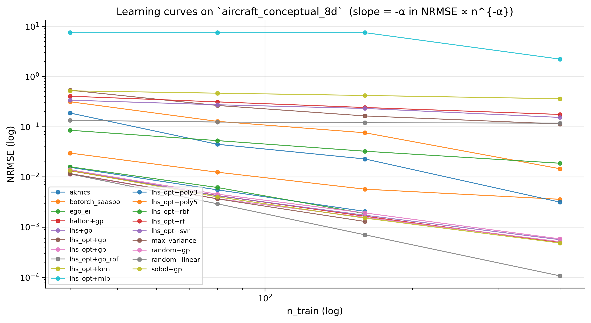

## 7c. Dimensional scaling

Does method ranking depend on case dimension?  We split cases
into 3 dimension bands (balanced by case count) and report
the mean rank in each band, plus the rank `range` across bands
— large `range` ⇒ ranking flips with dimension.

The NRMSE-vs-dim slope (in log space) measures
*curse-of-dimensionality severity* per method at the largest
budget: large positive slope ⇒ accuracy degrades quickly with d.

**Mean rank by dimension band** (cases per band: 19 in low (d≤5), 13 in mid (6–10), 2 in high (d≥11))

| method | low (d≤5) | mid (6–10) | high (d≥11) | range |
|---|---|---|---|---|
| max_variance | 2.842 | — | — | 0.000 |
| lhs_opt+gp | 3.211 | 2.538 | — | 0.672 |
| halton+gp | 3.579 | 2.769 | — | 0.810 |
| sobol+gp | 3.684 | 1.923 | — | 1.761 |
| lhs_opt+gp_rbf | 5.895 | 5.231 | — | 0.664 |
| lhs+gp | 6.000 | 4.538 | — | 1.462 |
| random+gp | 6.684 | 5.308 | — | 1.377 |
| botorch_saasbo | 7.947 | 6.923 | — | 1.024 |
| ego_ei | 8.526 | — | — | 0.000 |
| akmcs | 9.105 | — | — | 0.000 |
| botorch_qei | 10.789 | 8.333 | — | 2.456 |
| lhs_opt+rbf | 12.421 | 9.615 | 1.000 | 11.421 |
| lhs_opt+poly5 | 12.947 | 10.154 | 4.500 | 8.447 |
| lhs_opt+poly3 | 13.526 | 10.385 | 6.000 | 7.526 |
| lhs_opt+rf | 15.526 | 13.000 | 7.000 | 8.526 |
| lhs_opt+gb | 15.737 | 11.692 | 3.000 | 12.737 |
| lhs_opt+svr | 16.579 | 13.154 | 2.000 | 14.579 |
| lhs_opt+mlp | 16.947 | 13.462 | 5.500 | 11.447 |
| lhs_opt+knn | 18.421 | 15.769 | 9.000 | 9.421 |
| random+linear | 19.632 | 15.538 | 7.000 | 12.632 |

**Curse-of-dim severity at 50·d budget** (log-NRMSE vs dim regression):

| method | n_cases | log_slope | intercept | R2 | spearman_rho | p_value |
|---|---|---|---|---|---|---|
| ego_ei | 19 | -0.028 | -2.764 | 0.000 | 0.128 | 0.601 |
| max_variance | 19 | -0.027 | -3.069 | 0.000 | 0.091 | 0.711 |
| random+linear | 34 | 0.010 | -0.893 | 0.006 | -0.073 | 0.683 |
| akmcs | 19 | 0.022 | -2.938 | 0.000 | 0.136 | 0.580 |
| lhs_opt+mlp | 34 | 0.022 | -1.051 | 0.008 | 0.147 | 0.406 |
| lhs_opt+svr | 34 | 0.042 | -1.609 | 0.077 | 0.168 | 0.343 |
| botorch_qei | 28 | 0.046 | -2.872 | 0.001 | -0.061 | 0.758 |
| lhs_opt+gb | 34 | 0.052 | -1.800 | 0.096 | 0.187 | 0.288 |
| lhs_opt+knn | 34 | 0.058 | -1.277 | 0.435 | 0.541 | 0.001 |
| lhs_opt+rbf | 34 | 0.069 | -2.368 | 0.079 | 0.200 | 0.256 |
| lhs_opt+rf | 34 | 0.073 | -1.801 | 0.200 | 0.347 | 0.044 |
| lhs_opt+gp_rbf | 32 | 0.074 | -3.619 | 0.003 | 0.079 | 0.666 |
| lhs_opt+poly3 | 34 | 0.081 | -2.473 | 0.052 | 0.160 | 0.366 |
| lhs_opt+poly5 | 34 | 0.088 | -2.524 | 0.078 | 0.197 | 0.264 |
| random+gp | 32 | 0.099 | -3.619 | 0.009 | 0.065 | 0.725 |
| lhs+gp | 32 | 0.105 | -3.687 | 0.010 | 0.068 | 0.711 |
| sobol+gp | 32 | 0.111 | -3.802 | 0.010 | 0.090 | 0.623 |
| halton+gp | 32 | 0.113 | -3.803 | 0.011 | 0.091 | 0.621 |
| lhs_opt+gp | 32 | 0.117 | -3.836 | 0.012 | 0.085 | 0.642 |
| botorch_saasbo | 32 | 0.144 | -3.620 | 0.029 | 0.074 | 0.687 |

**Convergence-rate α correlated with dimension** (per-method Spearman ρ of α vs case dim):

| method | n_cases | alpha_mean | alpha_low_d | alpha_high_d | spearman_rho_alpha_vs_dim | p_value |
|---|---|---|---|---|---|---|
| max_variance | 33 | 0.756 | 0.767 | 0.742 | -0.176 | 0.328 |
| lhs_opt+gp_rbf | 34 | 0.747 | 0.775 | 0.710 | -0.355 | 0.039 |
| ego_ei | 33 | 0.711 | 0.722 | 0.696 | -0.180 | 0.316 |
| sobol+gp | 34 | 0.705 | 0.741 | 0.659 | -0.279 | 0.110 |
| random+gp | 34 | 0.701 | 0.733 | 0.662 | -0.290 | 0.096 |
| akmcs | 33 | 0.700 | 0.706 | 0.691 | -0.194 | 0.280 |
| halton+gp | 34 | 0.698 | 0.727 | 0.661 | -0.249 | 0.156 |
| lhs+gp | 34 | 0.693 | 0.727 | 0.650 | -0.272 | 0.120 |
| lhs_opt+gp | 34 | 0.677 | 0.711 | 0.632 | -0.260 | 0.137 |
| lhs_opt+gb | 34 | 0.616 | 0.675 | 0.541 | -0.339 | 0.050 |
| botorch_qei | 29 | 0.592 | 0.602 | 0.573 | -0.116 | 0.549 |
| botorch_saasbo | 34 | 0.586 | 0.626 | 0.534 | -0.319 | 0.066 |
| lhs_opt+poly5 | 34 | 0.503 | 0.487 | 0.525 | -0.178 | 0.313 |
| lhs_opt+poly3 | 34 | 0.437 | 0.404 | 0.479 | -0.076 | 0.670 |
| lhs_opt+rbf | 34 | 0.367 | 0.381 | 0.350 | -0.235 | 0.182 |
| lhs_opt+svr | 34 | 0.309 | 0.326 | 0.289 | -0.225 | 0.201 |
| lhs_opt+mlp | 34 | 0.301 | 0.258 | 0.356 | 0.399 | 0.019 |
| lhs_opt+rf | 34 | 0.291 | 0.321 | 0.253 | -0.426 | 0.012 |
| lhs_opt+knn | 34 | 0.180 | 0.216 | 0.135 | -0.754 | 0.000 |
| random+linear | 34 | 0.056 | 0.059 | 0.051 | -0.550 | 0.001 |

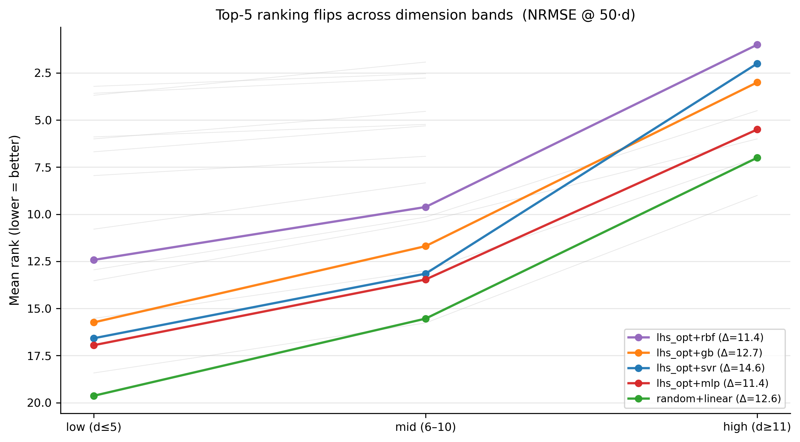

## 8. Method robustness (per-rep variance)

For each method we compute the std of NRMSE across the repeats
on each case, then average.  Methods with low headline NRMSE but
high CV are *brittle to the seed* and should be reported with
caution.

| method | mean_nrmse | mean_per_rep_std | max_per_rep_std | mean_cv |
|---|---|---|---|---|
| random+linear | 0.476 | 0.004 | 0.012 | 0.008 |
| lhs_opt+knn | 0.424 | 0.010 | 0.024 | 0.023 |
| lhs_opt+svr | 0.296 | 0.006 | 0.025 | 0.023 |
| lhs_opt+gb | 0.265 | 0.009 | 0.039 | 0.034 |
| lhs_opt+poly3 | 0.222 | 0.010 | 0.075 | 0.038 |
| lhs_opt+rf | 0.301 | 0.012 | 0.075 | 0.039 |
| lhs_opt+poly5 | 0.211 | 0.009 | 0.035 | 0.043 |
| lhs_opt+rbf | 0.193 | 0.008 | 0.037 | 0.044 |
| lhs_opt+mlp | 0.627 | 0.035 | 0.304 | 0.056 |
| lhs_opt+gp | 0.107 | 0.009 | 0.051 | 0.099 |
| botorch_qei | 0.132 | 0.014 | 0.047 | 0.114 |
| botorch_saasbo | 0.122 | 0.013 | 0.136 | 0.120 |
| lhs+gp | 0.113 | 0.011 | 0.057 | 0.120 |
| sobol+gp | 0.108 | 0.013 | 0.058 | 0.127 |
| random+gp | 0.114 | 0.013 | 0.050 | 0.151 |
| ego_ei | 0.120 | 0.017 | 0.063 | 0.152 |
| halton+gp | 0.109 | 0.015 | 0.150 | 0.155 |
| akmcs | 0.131 | 0.022 | 0.100 | 0.158 |
| max_variance | 0.102 | 0.020 | 0.108 | 0.183 |
| lhs_opt+gp_rbf | 0.130 | 0.033 | 0.158 | 0.291 |

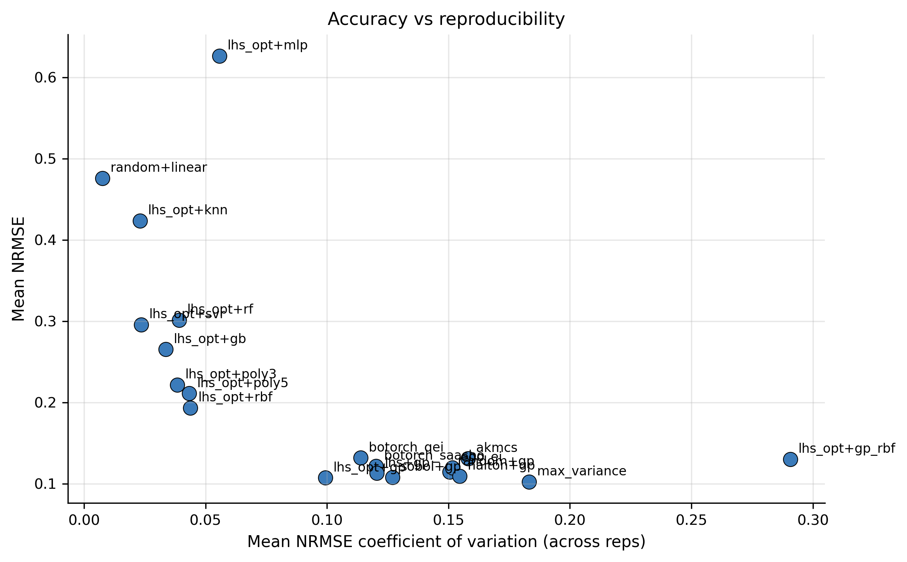

## 9. Cross-metric ranking robustness

Spearman ρ between rankings induced by alternative metrics.
Values close to 1 mean the headline conclusion is robust to the
choice of accuracy metric.

| metric | nrmse | rmse | mae | maxae | q95ae | r2 |
|---|---|---|---|---|---|---|
| nrmse | 1.000 | 1.000 | 1.000 | 1.000 | 1.000 | 1.000 |
| rmse | 1.000 | 1.000 | 1.000 | 1.000 | 1.000 | 1.000 |
| mae | 1.000 | 1.000 | 1.000 | 1.000 | 1.000 | 1.000 |
| maxae | 1.000 | 1.000 | 1.000 | 1.000 | 1.000 | 1.000 |
| q95ae | 1.000 | 1.000 | 1.000 | 1.000 | 1.000 | 1.000 |
| r2 | 1.000 | 1.000 | 1.000 | 1.000 | 1.000 | 1.000 |

**Min Spearman ρ across all metric pairs**: 0.9996

## 10. Fit-quality flags

Per-(case, method) flag of degenerate / failed fits:

- `crashed`     : run raised an exception
- `nrmse>5`     : worse than naive mean predictor
- `r2<0`        : negative R² (worse than mean)
- `nan_pred`    : surrogate produced NaN predictions

| method | case_id | budget_mult | nrmse_mean | nrmse_std | nrmse_max | r2_mean | picp_mean | n_reps | flags |
|---|---|---|---|---|---|---|---|---|---|
| akmcs | airfoil_stall_2d | 50 | 0.225 | 0.036 | 0.362 | 0.942 | 0.768 | 30 | ok |
| akmcs | airfoil_transonic_5d | 50 | 0.110 | 0.005 | 0.125 | 0.987 | 0.931 | 30 | ok |
| akmcs | cantilever_beam_5d | 50 | 0.300 | 0.074 | 0.565 | 0.825 | 0.880 | 30 | ok |
| akmcs | casting_solidification_5d | 50 | 0.133 | 0.026 | 0.199 | 0.956 | 0.928 | 30 | ok |
| akmcs | fin_heat_sink_4d | 50 | 0.031 | 0.002 | 0.035 | 0.999 | 0.927 | 30 | ok |
| akmcs | hetero_conduction_2d | 50 | 0.001 | 0.000 | 0.002 | 1.000 | 0.975 | 30 | ok |
| akmcs | laminar_flame_speed_5d | 50 | 0.008 | 0.002 | 0.009 | 1.000 | 0.970 | 2 | ok |
| akmcs | membrane_reactor_5d | 50 | 0.009 | 0.001 | 0.011 | 1.000 | 0.954 | 30 | ok |
| akmcs | multilayer_wall_4d | 50 | 0.085 | 0.005 | 0.100 | 0.992 | 0.918 | 30 | ok |
| akmcs | plate_with_hole_5d | 50 | 0.196 | 0.100 | 0.501 | 0.908 | 0.889 | 30 | ok |
| akmcs | pressure_vessel_4d | 50 | 0.069 | 0.017 | 0.110 | 0.985 | 0.960 | 30 | ok |
| akmcs | rocket_isp_4d | 50 | 0.008 | 0.000 | 0.009 | 1.000 | 0.918 | 30 | ok |
| akmcs | soil_consolidation_5d | 50 | 0.202 | 0.011 | 0.227 | 0.958 | 0.897 | 30 | ok |
| akmcs | supersonic_intake_5d | 50 | 0.114 | 0.015 | 0.144 | 0.969 | 0.915 | 30 | ok |
| akmcs | supersonic_nozzle_5d | 50 | 0.512 | 0.071 | 0.680 | 0.701 | 0.869 | 30 | ok |
| akmcs | thin_plate_buckling_5d | 50 | 0.098 | 0.024 | 0.139 | 0.986 | 0.853 | 30 | ok |
| akmcs | tuned_mass_damper_3d | 50 | 0.290 | 0.021 | 0.354 | 0.909 | 0.871 | 30 | ok |
| akmcs | variable_beam_5d | 50 | 0.097 | 0.011 | 0.127 | 0.985 | 0.928 | 30 | ok |
| akmcs | waverider_4d | 50 | 0.004 | 0.001 | 0.006 | 1.000 | 0.971 | 30 | ok |
| botorch_qei | airfoil_stall_2d | 50 | 0.200 | 0.017 | 0.242 | 0.954 | 0.754 | 30 | ok |

**Failure rate per method (over all budgets):**

| method | n_runs | n_crash | n_blowup | crash_rate | blowup_rate | total_failure_rate |
|---|---|---|---|---|---|---|
| akmcs | 3486 | 0 | 0 | 0.000 | 0.000 | 0.000 |
| botorch_qei | 3416 | 0 | 0 | 0.000 | 0.000 | 0.000 |
| botorch_saasbo | 4020 | 0 | 0 | 0.000 | 0.000 | 0.000 |
| ego_ei | 3520 | 0 | 0 | 0.000 | 0.000 | 0.000 |
| halton+gp | 4002 | 0 | 0 | 0.000 | 0.000 | 0.000 |
| lhs+gp | 3991 | 0 | 0 | 0.000 | 0.000 | 0.000 |
| lhs_opt+gb | 4080 | 0 | 0 | 0.000 | 0.000 | 0.000 |
| lhs_opt+gp | 4006 | 0 | 0 | 0.000 | 0.000 | 0.000 |
| lhs_opt+gp_rbf | 4019 | 0 | 0 | 0.000 | 0.000 | 0.000 |
| lhs_opt+knn | 4080 | 0 | 0 | 0.000 | 0.000 | 0.000 |
| lhs_opt+poly3 | 4080 | 0 | 0 | 0.000 | 0.000 | 0.000 |
| lhs_opt+poly5 | 4080 | 0 | 0 | 0.000 | 0.000 | 0.000 |
| lhs_opt+rf | 4080 | 0 | 0 | 0.000 | 0.000 | 0.000 |
| lhs_opt+rbf | 4080 | 0 | 0 | 0.000 | 0.000 | 0.000 |
| lhs_opt+svr | 4080 | 0 | 0 | 0.000 | 0.000 | 0.000 |
| max_variance | 3426 | 0 | 0 | 0.000 | 0.000 | 0.000 |
| random+linear | 4080 | 0 | 0 | 0.000 | 0.000 | 0.000 |
| random+gp | 4001 | 0 | 0 | 0.000 | 0.000 | 0.000 |
| sobol+gp | 3998 | 0 | 0 | 0.000 | 0.000 | 0.000 |
| lhs_opt+mlp | 4080 | 0 | 299 | 0.000 | 0.073 | 0.073 |

## 11. Per-case performance and winners

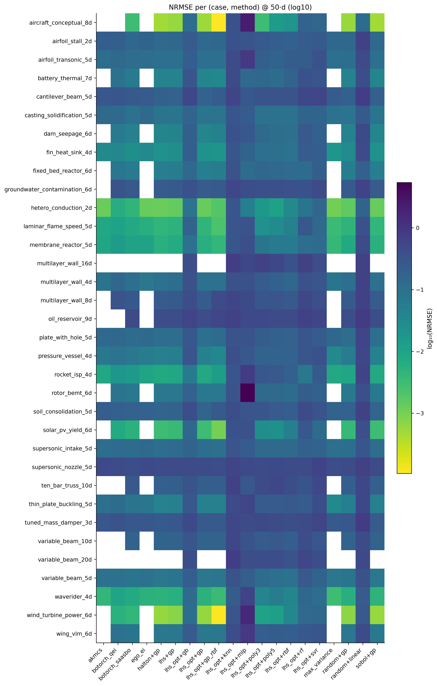

**Winner counts:**

| method | cases_won |
|---|---|
| sobol+gp | 11 |
| max_variance | 8 |
| lhs_opt+gp_rbf | 5 |
| halton+gp | 3 |
| lhs_opt+gp | 2 |
| lhs_opt+rbf | 2 |
| lhs+gp | 1 |
| ego_ei | 1 |
| botorch_saasbo | 1 |

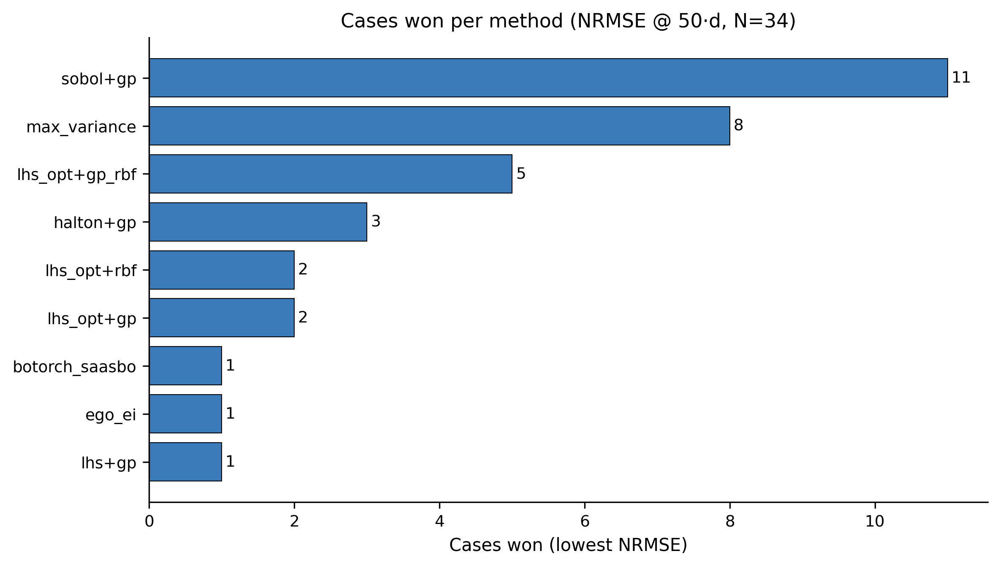

## Methodological notes

- **Test set**: each case uses 1000 Sobol-sampled test points,
  held fixed across all methods within a case.  See
  ``benchmark.scripts.validate_test_protocol`` for empirical MC
  error analysis.
- **Reproducibility**: under fixed seed, all methods give
  bit-exact results across reruns (verified in
  ``benchmark.scripts.determinism_audit``).  Variation across
  repeats reflects intentional design seed variation only.
- **Statistical tests**: the headline Friedman test treats each
  case as one observation; the Nemenyi CD is computed at α=0.05
  using the standard studentized-range approximation.
- **CIs**: bootstrap CIs resample cases (not repeats) with
  replacement, n_boot=1000.

Author: Binglin Wang (NUDT).  Auto-generated report.
